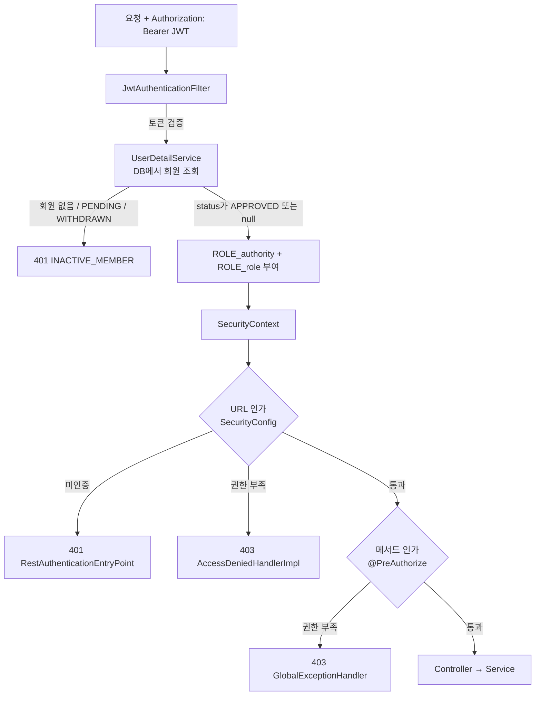

# 어드민 API 인증/인가 구조

어드민 API(`/admin/**`)의 역할 기반 접근 제어, 회원 상태 검증, OWNER 전용 기능과 운영 시 필요한 설정을 정리한 문서입니다.

## 1. 배경: 기존 구조의 문제

| # | 문제 | 영향 |
|---|---|---|
| 1 | `/admin/**`가 `anyRequest().authenticated()`로만 보호되고 있었음 | 로그인만 하면 일반 학회원(YB/OB)도 학회 소개, 프로젝트, 후기를 등록·수정·삭제할 수 있었음 |
| 2 | `MemberRole {YB, OB, ADMIN}` 하나에 **학회원 구분**과 **어드민 권한**이 섞여 있었음 | 로그인할 때 기수로 YB/OB를 다시 계산하면서 `ADMIN`이 덮어써짐. 기수가 있는 운영진은 로그인할 때마다 권한을 잃음 |
| 3 | `GlobalExceptionHandler`가 `RuntimeException`을 모두 잡음 | `@PreAuthorize`가 던진 `AccessDeniedException`까지 잡혀 권한 거부가 **HTTP 200 + 본문 code 500**으로 응답됨 |
| 4 | `AccessDeniedHandlerImpl`이 403이 아니라 401을 반환함 | FE가 토큰 문제와 권한 부족을 구분할 수 없음 |
| 5 | JWT 필터가 회원 상태를 확인하지 않음 | 탈퇴했거나 승인 대기 중인 회원의 토큰도 만료 전까지 계속 사용 가능 |

## 2. 역할 모델

변경 주체와 시점이 다른 두 개념을 별도 필드로 관리합니다.

| 필드 | 값 | 의미 | 변경 시점 |
|---|---|---|---|
| `role` (`MemberRole`) | `YB`, `OB` | 현재 기수 기준 학회원 구분 | 로그인 또는 현재 기수 변경 시 자동 계산 |
| `authority` (`MemberAuthority`) | `MEMBER`, `MANAGER`, `OWNER` | 어드민 권한 | OWNER 전용 API로 변경 |

- `MemberRole.ADMIN`은 기존 DB 값을 읽기 위해 `@Deprecated` 상태로만 남아 있습니다. 서버 기동 시 `MANAGER` 권한과 YB/OB 역할로 이전합니다(6장 참고).
- `authority` 컬럼 추가 전에 생성된 회원은 값이 `null`일 수 있습니다. `Member.getAuthority()`는 이 경우를 `MEMBER`로 취급합니다.
- 가입 승인 기능 도입 전에 생성된 회원은 `status`가 `null`일 수 있습니다. `Member.isActive()`는 레거시 `null` 상태를 활성 회원으로 취급하고, `PENDING`과 `WITHDRAWN`만 비활성으로 처리합니다.

### 권한 계층 (`RoleHierarchy`)

```text
ROLE_OWNER > ROLE_MANAGER > ROLE_MEMBER
```

상위 권한은 하위 권한을 포함합니다. 따라서 `hasRole('MANAGER')`가 적용된 API에는 OWNER도 접근할 수 있습니다.

### 권한별 접근 범위

| API | MEMBER (YB/OB) | MANAGER | OWNER |
|---|---|---|---|
| 공개 API (`/api/**` 중 permitAll 대상) | ✅ | ✅ | ✅ |
| 로그인 필요 API (`/api/mypage/**`, `/api/chat/**`, `/api/auth/logout`) | ✅ | ✅ | ✅ |
| 어드민 콘텐츠·회원 관리 (`/admin/**`) | ❌ 403 | ✅ | ✅ |
| OWNER 전용 API (`/admin/owner/**`) | ❌ 403 | ❌ 403 | ✅ |

OWNER 전용 API에는 회원 권한 변경과 현재 기수 변경이 포함됩니다.

## 3. 요청 처리 흐름



### 3-1. 인증: 권한은 요청마다 DB에서 읽음

- JWT에는 회원 PK가 subject로 들어가며 권한 정보는 넣지 않습니다.
- `JwtAuthenticationFilter`가 `UserDetailService.loadUserByUsername()`을 호출해 요청마다 DB에서 회원을 조회합니다.
- `UserPrincipal.create()`는 다음 두 종류의 권한을 부여합니다.
  - `ROLE_{authority}`: `ROLE_MEMBER`, `ROLE_MANAGER`, `ROLE_OWNER`
  - `ROLE_{role}`: `ROLE_YB`, `ROLE_OB` (role이 있을 때만)
- 권한 승격·강등은 토큰 재발급 없이 다음 요청부터 반영됩니다.
- `PENDING` 또는 `WITHDRAWN` 회원은 `DisabledException`이 발생해 401(`INACTIVE_MEMBER`)로 응답합니다.
- 가입 승인 기능 도입 전 회원(`status == null`)은 기존 서비스 이용이 막히지 않도록 활성 회원으로 취급합니다.

### 3-2. 인가: URL과 메서드 이중 방어

URL 레벨은 `SecurityConfig`에서 보호합니다.

```java
.antMatchers(HttpMethod.OPTIONS, "/**").permitAll()
.antMatchers("/admin/owner/**").hasRole("OWNER")
.antMatchers("/admin/**").hasRole("MANAGER")
.antMatchers("/api/mypage/**", "/api/chat/**", "/api/auth/logout").authenticated()
.antMatchers("/api/**", ...).permitAll()
```

- 규칙은 위에서부터 먼저 일치하는 항목이 적용되므로 `/admin/owner/**`를 `/admin/**`보다 앞에 둡니다.
- `/admin` 아래에 새 API가 추가되면 기본적으로 MANAGER 이상만 접근할 수 있습니다.

메서드 레벨은 컨트롤러의 `@PreAuthorize`로 한 번 더 보호합니다.

| 컨트롤러 | 어노테이션 |
|---|---|
| `AdminController` | `@PreAuthorize("hasRole('MANAGER')")` |
| `OwnerController` | `@PreAuthorize("hasRole('OWNER')")` |

## 4. 권한 변경 API (OWNER 전용)

```http
PATCH /admin/owner/members/{userId}/authority
Content-Type: application/json

{ "authority": "MEMBER" | "MANAGER" | "OWNER" }
```

`MemberAuthorityService.changeAuthority()`는 다음 순서로 검증합니다.

1. 변경할 권한이 없으면 400을 반환합니다.
2. 자기 자신의 권한은 변경할 수 없습니다.
3. OWNER 행에 비관적 락을 겁니다 (`@Lock(PESSIMISTIC_WRITE)`).
4. 대상 회원이 없으면 400을 반환합니다.
5. 비활성 회원(`PENDING`, `WITHDRAWN`)에게는 권한을 부여할 수 없습니다. 레거시 `status == null` 회원은 허용합니다.
6. 이미 같은 권한이면 변경 없이 성공합니다.
7. 마지막 OWNER는 강등할 수 없습니다.

### 왜 락이 필요한가

OWNER A와 B가 동시에 서로를 강등할 때 OWNER가 0명이 되는 것을 막기 위해 OWNER 조회와 강등을 하나의 트랜잭션으로 묶습니다.

```text
락이 없을 때
  T1(A→B 강등): OWNER 수 2명 확인 → B 강등
  T2(B→A 강등): OWNER 수 2명 확인 → A 강등
  결과: OWNER 0명

락이 있을 때
  T1: OWNER 행 잠금 → B 강등 → 커밋
  T2: 잠금 대기 → OWNER 1명 재확인 → 마지막 OWNER 강등 거부
```

## 5. 회원 관리 API (MANAGER 이상)

| Method | Path | 설명 |
|---|---|---|
| `GET` | `/admin/members?status={status}` | 전체 회원을 최신 가입순으로 조회하며 상태 필터를 지원 |
| `GET` | `/admin/members/pending` | 승인 대기 회원 조회 |
| `POST` | `/admin/members/{userId}/approve` | `PENDING` 회원을 승인하고 이메일 발송 |
| `POST` | `/admin/members/{userId}/reject` | `PENDING` 회원을 반려해 계정을 삭제하고 이메일 발송 |

- 승인·반려는 `PENDING` 회원에게만 수행할 수 있으며 다른 상태에는 400을 반환합니다.
- 이메일이 없거나 빈 값이면 상태 변경만 수행합니다.

## 6. 기존 데이터 마이그레이션과 OWNER 복구

`AdminAuthorityInitializer`가 서버 기동 시 실행됩니다.

1. **레거시 ADMIN 이전**: `member_role = 'ADMIN'`인 회원의 기본 권한이 `MEMBER`이면 `MANAGER`로 변경하고, role은 현재 기수 기준 YB/OB로 다시 계산합니다.
2. **OWNER 최초 지정·복구**: DB에 OWNER가 한 명도 없을 때만 `admin.owner-ids`에 지정된 활성 회원을 OWNER로 올립니다.

```properties
admin.owner-ids=owner1,owner2
```

- OWNER가 이미 한 명이라도 있으면 설정값으로 권한을 다시 덮어쓰지 않습니다.
- `admin.owner-ids`에 지정돼 있어도 `PENDING` 또는 `WITHDRAWN` 회원은 OWNER가 될 수 없습니다.
- 레거시 `status == null` 회원은 활성 회원으로 취급합니다.
- 이 프로젝트는 Flyway 없이 `ddl-auto=update`를 사용하므로 별도 SQL 대신 애플리케이션 기동 시 데이터를 이전합니다.
- 이전과 복구 과정은 반복 실행해도 같은 결과를 유지합니다.

## 7. 현재 기수 변경 (OWNER 전용)

```http
PUT /admin/owner/current-cardinal
Content-Type: application/json

{ "cardinal": 34 }
```

- 같은 기수는 변경 없이 성공 처리합니다.
- 오입력 방지를 위해 현재 기수의 다음 기수 또는 직전 기수로만 변경할 수 있습니다.
- 현재 기수 값이 `null`이면 복구를 위해 ±1 제한 없이 설정할 수 있습니다.
- 현재 기수 행을 비관적 락으로 조회해 동시 변경을 직렬화합니다.
- 변경 즉시 전체 회원의 YB/OB를 다시 계산합니다.
  - 가입 기수 `>=` 현재 기수: YB
  - 가입 기수 `<` 현재 기수: OB
  - 탈퇴 회원 또는 가입 기수가 없는 회원: 재계산 제외
- 응답에는 변경 전·후 기수와 YB→OB, OB→YB 변경 인원수가 포함됩니다.

현재 기수 행이 없는 빈 DB에서는 `CurrentCardinalInitializer`가 `member.initial-cardinal` 값으로 최초 행을 생성합니다. 기본값은 33입니다.

```properties
member.initial-cardinal=33
```

## 8. 로그인 응답

`MemberService.signin()`은 현재 기수에 따라 role을 다시 계산합니다. YB/OB 계산은 `resolveRole()`이 담당하며 authority는 변경하지 않습니다.

```json
{
  "accessToken": "...",
  "refreshToken": "...",
  "role": "OB",
  "authority": "MANAGER",
  "redirectPath": "/mypage/ob/profile"
}
```

어드민 FE는 `role == ADMIN`이 아니라 `authority`를 기준으로 접근 권한을 판별해야 합니다. MANAGER와 OWNER가 어드민에 접근할 수 있습니다.

## 9. 에러 응답 규칙

| 상황 | HTTP | code | message |
|---|---|---|---|
| 토큰 없음 | 401 | 401 | 인증되지 않은 사용자입니다. |
| 잘못된 형식·지원되지 않는 토큰 | 401 | 401 | 토큰 오류 사유 |
| 토큰 만료 | 401 | 401 | 액세스 토큰이 만료되었습니다. 토큰을 재발급해주세요. |
| 승인 대기 또는 탈퇴 회원 | 401 | 401 | 승인되지 않았거나 탈퇴한 회원입니다. |
| 로그인했지만 권한 부족 | 403 | 403 | 접근 권한이 없습니다. |
| 잘못된 요청·비즈니스 규칙 위반 | 400 | 400 | 요청별 사유 메시지 |
| 존재하지 않는 리소스 | 404 | 404 | 요청별 사유 메시지 |
| 처리되지 않은 서버 오류 | 500 | 500 | INTER SERVER ERROR |

401과 403 응답은 `application/json;charset=UTF-8` 형식이며 공통으로 `timestamp`, `code`, `message`를 포함합니다. 401은 `error`, 403은 `status` 필드에 HTTP 상태 문자열을 담습니다. `timestamp`도 문자열로 직렬화되므로 응답 본문은 유효한 JSON입니다.

FE는 401이면 토큰 갱신 또는 재로그인을 처리하고, 403이면 권한 부족 안내를 표시합니다.

`GlobalExceptionHandler`는 다음 순서로 예외를 구분합니다.

- 잘못된 enum·요청 바인딩과 `IllegalArgumentException`: 400
- `AccessDeniedException`: 403
- `EntityNotFoundException`: 404
- 처리되지 않은 `RuntimeException`: 500 및 서버 로그 기록

## 10. CORS

- CORS 설정은 `SecurityConfig`에서 관리합니다.
- 허용할 origin은 `cors.allowed-origins`에서 읽으며 값이 없으면 `*`을 사용합니다.
- `HEAD`, `POST`, `GET`, `DELETE`, `PUT`, `PATCH`, `OPTIONS`를 허용합니다.

```properties
cors.allowed-origins=https://kusitms.com,https://admin.kusitms.com
```

운영 환경에서는 실제 사이트 FE와 어드민 FE origin을 명시해야 합니다.

## 11. 테스트

`AdminAuthorizationTest`와 `CardinalTransitionTest`는 `@SpringBootTest`, MockMvc, H2(PostgreSQL 모드) 환경에서 실제 JWT와 보안 필터 체인을 사용합니다.

| 테스트 영역 | 검증 내용 |
|---|---|
| 어드민 접근 권한 | 비로그인 401, MEMBER 403, MANAGER·OWNER 200 |
| 회원 목록 | MANAGER 이상 접근, 상태 필터, authority 응답 포함 |
| 권한 변경 | OWNER 전용, 자기 자신 변경 금지, 즉시 반영 |
| 마지막 OWNER 보호 | OWNER 1명이면 강등 거부, 여러 명이면 강등 가능 |
| 회원 상태 | PENDING·WITHDRAWN 토큰 401, 레거시 `status == null` 허용 |
| 인증 오류 응답 | 401·403 본문이 유효한 JSON이며 timestamp가 문자열인지 확인 |
| 로그인 | 기수 기반 YB/OB 재계산과 MANAGER 권한 유지 |
| 레거시 ADMIN 이전 | MANAGER 권한과 현재 기수 기준 YB/OB로 이전 |
| 현재 기수 변경 | OWNER 전용, ±1 제한, 동일 값 재시도, 되돌리기, 전체 회원 역할 재계산 |
| 기수 기반 가입 | 현재 기수 기준 수료증 필수 여부 적용 |

실행:

```bash
./gradlew test --tests com.kusitms.website.domain.admin.AdminAuthorizationTest \
  --tests com.kusitms.website.domain.admin.CardinalTransitionTest
```

## 12. 관련 구현 파일

| 구분 | 파일 |
|---|---|
| 역할 모델 | `domain/user/entity/MemberAuthority.java`, `MemberRole.java`, `MemberStatus.java`, `Member.java` |
| 회원 저장소 | `domain/user/repository/MemberRepository.java`, `CurrentCardinalRepository.java` |
| 로그인·역할 계산 | `domain/user/service/MemberService.java`, `domain/user/dto/response/SignInResponse.java` |
| 인증 | `global/auth/UserPrincipal.java`, `UserDetailService.java`, `jwt/JwtAuthenticationFilter.java`, `RestAuthenticationEntryPoint.java` |
| 인가·CORS | `global/config/SecurityConfig.java`, `global/auth/AccessDeniedHandlerImpl.java` |
| 어드민 컨트롤러 | `domain/admin/controller/AdminController.java`, `OwnerController.java` |
| 권한 변경 | `domain/admin/service/MemberAuthorityService.java`, `domain/admin/dto/request/AuthorityUpdateRequest.java` |
| 회원 관리 | `domain/admin/service/MemberAdminService.java`, `domain/admin/dto/response/AdminMemberResponse.java`, `PendingMemberResponse.java` |
| 권한 이전·복구 | `domain/admin/service/AdminAuthorityInitializer.java` |
| 기수 전환 | `domain/admin/service/CardinalAdminService.java`, `domain/user/service/CurrentCardinalInitializer.java` |
| 에러 처리 | `global/common/BaseExceptionStatus.java`, `global/exception/GlobalExceptionHandler.java` |
| 테스트 | `AdminAuthorizationTest.java`, `CardinalTransitionTest.java`, `src/test/resources/application.properties` |

Java 파일 경로는 `src/main/java/com/kusitms/website/` 또는 `src/test/java/com/kusitms/website/`를 기준으로 표기했습니다.

## 13. 운영 설정 체크리스트

- Heroku Config Vars에 `admin.owner-ids`를 설정합니다. 이 값은 OWNER가 없을 때 최초 지정 또는 복구에만 사용됩니다.
- Heroku Config Vars에 `cors.allowed-origins`를 사이트 FE와 어드민 FE origin으로 설정합니다.
- 빈 DB에서 시작할 경우 `member.initial-cardinal`이 실제 운영 기수와 일치하는지 확인합니다.
- 배포 후 OWNER 계정, 현재 기수, 기존 ADMIN 이전 결과를 확인합니다.
