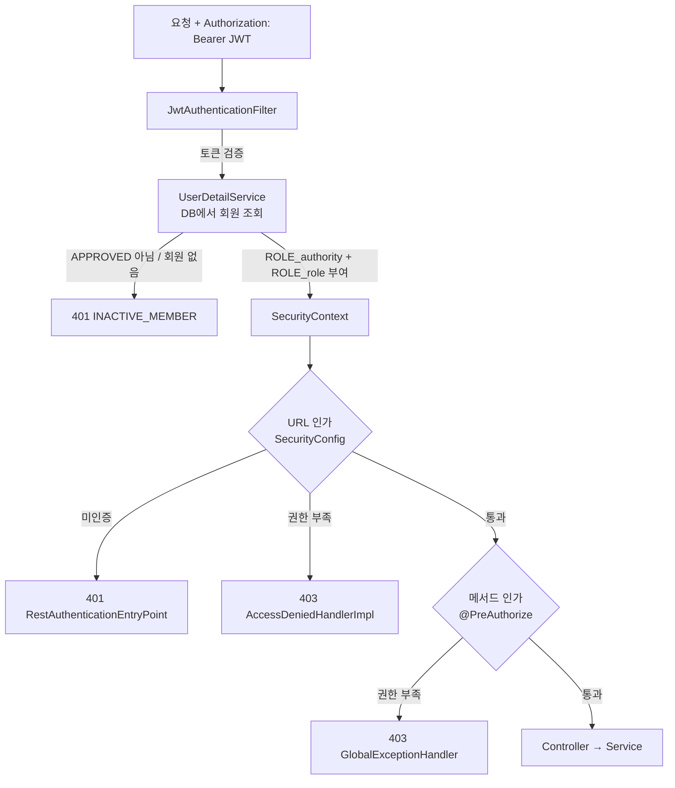

# 어드민 API 인증/인가 구조

어드민 API(`/admin/**`)에 역할 기반 접근 제어를 적용한 구조와 그렇게 설계한 이유를 정리한 문서입니다.

## 1. 배경: 기존 구조의 문제

| # | 문제 | 영향 |
|---|---|---|
| 1 | `/admin/**`가 `anyRequest().authenticated()`로만 보호되고 있었음 | 로그인만 하면 일반 학회원(YB/OB)도 학회 소개, 프로젝트, 후기를 등록·수정·삭제할 수 있었음 |
| 2 | `MemberRole {YB, OB, ADMIN}` 하나에 **학회원 구분**과 **어드민 권한**이 섞여 있었음 | 로그인할 때 기수로 YB/OB를 다시 계산하면서 `ADMIN`이 덮어써짐. 기수가 있는 운영진은 로그인할 때마다 권한을 잃음 |
| 3 | `GlobalExceptionHandler`가 `RuntimeException`을 모두 잡음 | `@PreAuthorize`가 던진 `AccessDeniedException`까지 잡혀, 권한 거부가 **HTTP 200 + 본문 code 500**으로 응답됨 |
| 4 | `AccessDeniedHandlerImpl`이 403이 아니라 401을 반환함 | FE가 "토큰 만료"와 "권한 없음"을 구분할 수 없음 |
| 5 | JWT 필터가 회원 상태를 확인하지 않음 | 탈퇴했거나 승인 대기 중인 회원의 토큰도 만료 전까지 계속 사용 가능 |

## 2. 역할 모델

**바뀌는 시점이 다른 두 개념을 별도 필드로 분리했습니다.**

| 필드 | 값 | 의미 | 변경 주체 |
|---|---|---|---|
| `role` (`MemberRole`) | `YB`, `OB` | 학회원 구분 (기수 기준) | 로그인할 때 자동 계산 |
| `authority` (`MemberAuthority`) | `MEMBER`, `MANAGER`, `OWNER` | 어드민 권한 | OWNER만 변경 가능 |

- `MemberRole.ADMIN`은 기존 DB 데이터를 읽을 수 있도록 `@Deprecated` 상태로만 남겨 두었습니다. 서버가 기동될 때 `MANAGER`로 이전됩니다(5장 참고).
- `authority` 컬럼이 생기기 전에 가입한 회원은 값이 `null`입니다. `Member.getAuthority()`에서 이 경우를 `MEMBER`로 취급합니다.

### 권한 계층 (`RoleHierarchy`)

```
ROLE_OWNER > ROLE_MANAGER > ROLE_MEMBER
```

상위 권한은 하위 권한을 포함합니다. 그래서 `hasRole('MANAGER')`라고 적으면 OWNER도 통과합니다. 권한 단계가 늘어나도 `hasAnyRole(...)` 목록을 고칠 필요가 없습니다.

### 권한별 접근 범위

| API | MEMBER (YB/OB) | MANAGER | OWNER |
|---|---|---|---|
| 공개 API (`/api/**`) | ✅ | ✅ | ✅ |
| 로그인 필요 API (`/api/mypage/**`, `/api/chat/**`, `/api/auth/logout`) | ✅ | ✅ | ✅ |
| 어드민 콘텐츠·회원 관리 (`/admin/**`) | ❌ 403 | ✅ | ✅ |
| 권한 변경 (`/admin/owner/**`) | ❌ 403 | ❌ 403 | ✅ |

## 3. 요청 처리 흐름



### 3-1. 인증: 권한은 요청마다 DB에서 읽음

- JWT에는 `userId`(subject)만 들어 있고, 권한 정보는 넣지 않습니다.
- `JwtAuthenticationFilter`가 `UserDetailService.loadUserByUsername()`을 호출해 **요청마다 DB에서 회원을 조회**합니다.
- `UserPrincipal.create()`는 두 종류의 권한을 부여합니다.
  - `ROLE_{authority}`: `ROLE_MEMBER`, `ROLE_MANAGER`, `ROLE_OWNER` 중 하나
  - `ROLE_{role}`: `ROLE_YB` 또는 `ROLE_OB` (role이 있을 때만)
- 이렇게 하면 다음 효과가 있습니다.
  - **권한 변경이 즉시 반영됩니다.** 승격되거나 강등된 회원은 토큰을 다시 발급받지 않아도 다음 요청부터 새 권한이 적용됩니다.
  - **탈퇴나 승인 취소도 즉시 반영됩니다.** `status != APPROVED`이면 `DisabledException`이 발생해 401(`INACTIVE_MEMBER`)로 응답합니다.
- 대신 요청마다 회원을 PK로 한 번 조회하는 비용이 듭니다. 지금 트래픽 규모에서는 문제가 되지 않는 수준입니다.

### 3-2. 인가: URL과 메서드 이중 방어

**URL 레벨**: `SecurityConfig`

```java
.antMatchers(HttpMethod.OPTIONS, "/**").permitAll()
.antMatchers("/admin/owner/**").hasRole("OWNER")
.antMatchers("/admin/**").hasRole("MANAGER")
.antMatchers("/api/mypage/**", "/api/chat/**", "/api/auth/logout").authenticated()
.antMatchers("/api/**", ...).permitAll()
```

- 규칙은 위에서부터 먼저 일치하는 것이 적용됩니다. 그래서 좁은 범위(`/admin/owner/**`)를 넓은 범위(`/admin/**`)보다 앞에 둡니다.
- 나중에 `/admin` 아래에 새 API가 생겨도 **기본으로 MANAGER 이상만 접근**할 수 있습니다.

**메서드 레벨**: 컨트롤러 클래스에 `@PreAuthorize`

| 컨트롤러 | 어노테이션 |
|---|---|
| `AdminController` | `@PreAuthorize("hasRole('MANAGER')")` |
| `OwnerController` | `@PreAuthorize("hasRole('OWNER')")` |

URL 규칙이 실수로 바뀌거나 경로가 옮겨져도 메서드 레벨에서 한 번 더 막힙니다.

## 4. 권한 변경 API (OWNER 전용)

```
PATCH /admin/owner/members/{userId}/authority
{ "authority": "MEMBER" | "MANAGER" | "OWNER" }
```

`MemberAuthorityService.changeAuthority(actorUserId, targetUserId, newAuthority)`의 검증 순서는 다음과 같습니다.

1. `newAuthority`가 비어 있으면 400을 반환합니다.
2. **자기 자신은 변경할 수 없습니다.** 실수로 스스로를 강등하거나, 스스로 권한을 조작하는 것을 막습니다.
3. **OWNER 행에 비관적 락을 겁니다** (`@Lock(PESSIMISTIC_WRITE)`, `SELECT … FOR UPDATE`).
4. 대상 회원이 없으면 400을 반환합니다.
5. **APPROVED 상태인 회원에게만** 권한을 줄 수 있습니다.
6. 이미 같은 권한이면 아무것도 하지 않습니다.
7. **마지막 OWNER는 강등할 수 없습니다.**

### 왜 락이 필요한가

OWNER A와 B가 **동시에** 서로를 강등하는 상황을 생각해 보겠습니다.

```
락이 없을 때
  T1(A→B 강등): OWNER 수 조회 = 2 → 통과 → B 강등
  T2(B→A 강등): OWNER 수 조회 = 2 → 통과 → A 강등
  결과: OWNER 0명 → 아무도 권한을 관리할 수 없음

락이 있을 때
  T1: OWNER 행 잠금 → 2명 확인 → B 강등 → 커밋
  T2: 잠금 대기 → T1 커밋 후 조회 → OWNER는 A 1명
      → A를 강등하면 OWNER가 0명이 되므로 "마지막 OWNER는 강등할 수 없습니다"로 거부
```

OWNER 수를 세는 것과 강등하는 것을 하나의 원자적 단위로 묶기 위해 OWNER 행을 잠급니다.

## 5. 기존 데이터 마이그레이션

`AdminAuthorityInitializer`(`ApplicationRunner`)가 서버 기동 시 실행됩니다.

1. **레거시 ADMIN 이전**: `member_role = 'ADMIN'`인 회원을 `authority = MANAGER`로 바꾸고, `role`은 `MemberService.resolveRole()`로 다시 계산한 YB/OB로 되돌립니다.
2. **최초 OWNER 지정**: `admin.owner-ids`에 적힌 로그인 ID 중 APPROVED 상태인 회원을 OWNER로 올립니다.

```properties
admin.owner-ids=owner1,owner2
```

- 이 프로젝트는 Flyway 없이 `ddl-auto=update`를 쓰고 있습니다. 그래서 별도 SQL 스크립트를 두지 않고, 애플리케이션 기동 시점에 데이터를 이전하도록 했습니다.
- 두 작업 모두 **멱등**합니다. 한 번 이전된 회원은 다시 처리되지 않으므로 재시작해도 안전합니다.
- 운영 DB에 직접 SQL을 실행하지 않고 설정값만으로 첫 OWNER를 만들 수 있습니다.

## 6. 로그인 응답 변경

`MemberService.signin()`에서 기수에 따라 role을 다시 계산하는 로직은 `resolveRole()`로 추출했습니다. 이 메서드는 **YB/OB만 다루고 `authority`는 건드리지 않습니다.**

```json
{
  "accessToken": "...",
  "refreshToken": "...",
  "role": "OB",
  "authority": "MANAGER",
  "redirectPath": "/mypage/ob/profile"
}
```

어드민 FE는 `authority !== 'MEMBER'`로 어드민 화면 접근을 판별합니다.

## 7. 에러 응답 규칙

| 상황 | HTTP | code | message |
|---|---|---|---|
| 토큰 없음 | 401 | 401 | 인증되지 않은 사용자입니다. |
| 토큰 만료 | 401 | 401 | 액세스 토큰이 만료되었습니다. 토큰을 재발급해주세요. |
| 탈퇴했거나 승인 대기 중인 회원 | 401 | 401 | 승인되지 않았거나 탈퇴한 회원입니다. |
| 로그인했지만 권한 부족 | **403** | **403** | 접근 권한이 없습니다. |
| 비즈니스 규칙 위반 (자기 자신 변경 등) | 400 | 400 | 사유 메시지 |
| 처리되지 않은 서버 오류 | **500** | 500 | INTER SERVER ERROR |

FE는 **401이면 토큰 갱신 또는 재로그인**, **403이면 권한 없음 안내**로 처리합니다.

`GlobalExceptionHandler`는 `AccessDeniedException`을 `RuntimeException`보다 먼저 처리해 403으로 응답합니다. `RuntimeException` 핸들러도 이제 200이 아니라 실제 HTTP 500을 반환하고, 에러 로그를 남깁니다.

## 8. CORS

- 중복이던 `WebConfig`의 CORS 설정을 삭제하고 `SecurityConfig` 한 곳으로 합쳤습니다.
- 허용할 origin은 설정 파일에서 읽습니다. 값을 지정하지 않으면 기존처럼 `*`을 허용합니다.

```properties
cors.allowed-origins=https://kusitms.com,https://admin.kusitms.com
```

- 권한 변경 API에 쓰이는 `PATCH`와 preflight용 `OPTIONS` 메서드를 허용 목록에 추가했습니다.

## 9. 테스트

`AdminAuthorizationTest`: `@SpringBootTest` + MockMvc + H2(PostgreSQL 모드). 실제 JWT를 발급해서 필터 체인 전체를 통과시키는 방식으로 검증합니다.

| 테스트 | 검증 내용 |
|---|---|
| 어드민 콘텐츠 API | 비로그인 401, YB 403, MANAGER 200, OWNER 200 (계층) |
| 회원 목록 API | MEMBER 403, MANAGER 200, 응답에 authority 포함 |
| 권한 변경 API | MANAGER 403, OWNER 200, 변경된 권한이 기존 토큰에 즉시 반영 |
| 자기 자신 변경 | 400 |
| 마지막 OWNER 보호 | 1명이면 거부, 2명이면 강등 가능 |
| 미승인 회원 권한 부여 | 거부 |
| 로그인 필요 / 공개 API | 401 / 200 |
| 탈퇴 회원 토큰 | 만료 전이라도 401 |
| 기수 있는 운영진 로그인 | role=YB, authority=MANAGER 유지 |
| 레거시 ADMIN 마이그레이션 | MANAGER + OB로 이전 |

실행:

```bash
./gradlew test
```

## 10. 변경 파일

| 구분 | 파일 |
|---|---|
| 역할 모델 | `domain/user/MemberAuthority.java` (신규), `MemberRole.java`, `Member.java`, `MemberRepository.java` |
| 로그인 | `domain/user/MemberService.java`, `dto/response/SignInResponse.java` |
| 인증 | `global/auth/UserPrincipal.java`, `UserDetailService.java`, `jwt/JwtAuthenticationFilter.java`, `RestAuthenticationEntryPoint.java` |
| 인가 | `global/config/SecurityConfig.java`, `domain/admin/AdminController.java`, `OwnerController.java` (신규) |
| 권한 변경 | `domain/admin/MemberAuthorityService.java` (신규), `dto/request/AuthorityUpdateRequest.java` (신규) |
| 회원 목록 | `domain/admin/MemberAdminService.java`, `dto/response/AdminMemberResponse.java` (신규) |
| 마이그레이션 | `domain/admin/AdminAuthorityInitializer.java` (신규) |
| 에러 처리 | `global/common/BaseExceptionStatus.java`, `global/auth/AccessDeniedHandlerImpl.java`, `global/exception/GlobalExceptionHandler.java` |
| CORS | `global/config/WebConfig.java` (삭제) |
| 테스트 | `AdminAuthorizationTest.java` (신규), `src/test/resources/application.properties`, `build.gradle` |

## 11. 남은 작업

- FE 회원 관리 화면에 필요한 회원 상태 변경, 회원 삭제 API를 추가해야 합니다. 백엔드에 "반려됨" 상태를 둘지 먼저 정해야 합니다.
- 운영 환경에 `admin.owner-ids`와 `cors.allowed-origins`를 설정해야 합니다.
- 사이트 FE가 오류 응답의 HTTP 상태가 200이 아니라 500으로 바뀐 것에 영향을 받는지 확인해야 합니다.
